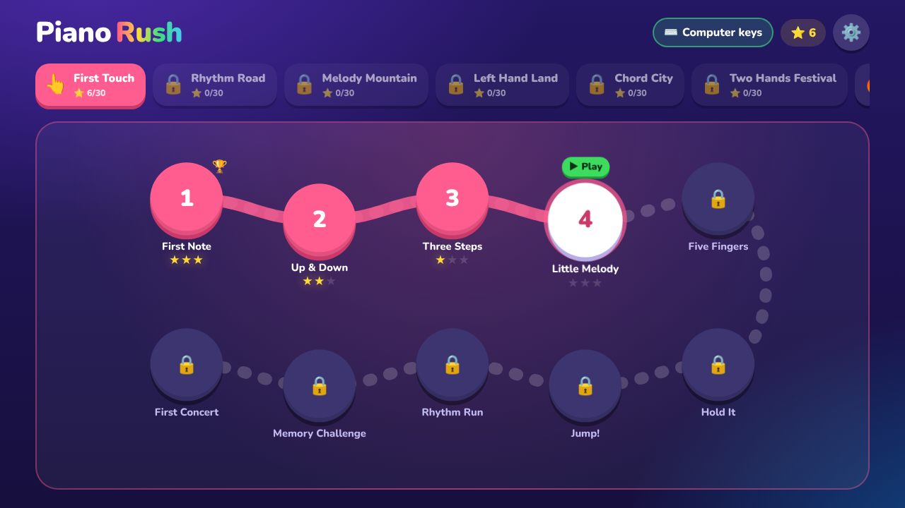
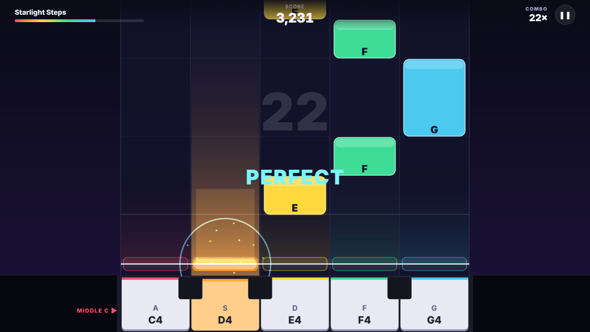

# Piano Rush

A rhythm game you play with a **real piano**. Tiles fall toward a hit line in fixed lanes, and each lane is one physical key. You play the key when its tile reaches the line.

Current state: **Milestone 4: MVP completion**, built on M1 (playable prototype), M2 (World 1 learning path) and M3 (audio).

- **M1** added Web MIDI input, a keyboard simulator, a frame-rate-independent scoring engine and a PixiJS renderer.
- **M2** adds:
  - ten original World 1 levels with stars and unlocks;
  - Discover, Flow and Challenge modes;
  - scoring for long-note releases;
  - chord scoring.
- **M3** adds:
  - a generated backing track (drums, bass and chords) in sync with the tiles;
  - a built-in piano sound;
  - count-in clicks and an optional metronome;
  - volume controls;
  - tap-along timing calibration.
- **M4** adds:
  - a first-launch setup guide;
  - practice speed;
  - offline play and installing as an app;
  - a note-labels setting.





## Quick start

```bash
npm install
npm run dev        # http://localhost:5173
```

Open the URL in **desktop Chrome or Edge**. Then either:

- click **Connect MIDI piano** and choose your keyboard, or
- leave **Play with keyboard simulator** on and use `A S D F G`.

On first launch a short **setup guide** walks you through it:
1. Choose how you'll play: MIDI piano or computer keyboard.
2. Connect your piano.
3. **Find your keys:** the game asks for middle C, then D, E, F and G. A wrong key gets a hint, e.g. "That was E4. C4 is 2 white keys to the left", or "right note, one octave too high".
4. Pick the piano sound, with test buttons.
5. Optionally calibrate, then start level 1.

You can reopen the guide any time from **Setup guide** on the home screen.

After that: pick a level (only level 1 is open at first), choose a mode and a **speed**, and press **Play**. Full speed earns stars; 75% and 50% are practice runs that slow down the tiles, the judging and the backing together.

## Commands

| Command             | What it does                                         |
| ------------------- | ---------------------------------------------------- |
| `npm run dev`       | Vite dev server with hot reload                      |
| `npm test`          | Run all Vitest unit tests once (deterministic, no browser) |
| `npm run test:watch`| Vitest in watch mode                                 |
| `npm run typecheck` | TypeScript strict type check                         |
| `npm run build`     | Type check + production build into `dist/`           |
| `npm run preview`   | Serve the production build locally (with the offline service worker) |

Add `?debug` to the URL (e.g. `http://localhost:5173/?debug`) to show an FPS / song-time readout during play.

## How to play

| Lane | Piano key | MIDI | Simulator key |
| ---- | --------- | ---- | ------------- |
| 1    | C4 (middle C) | 60 | `A` |
| 2    | D4        | 62   | `S`           |
| 3    | E4        | 64   | `D`           |
| 4    | F4        | 65   | `F`           |
| 5    | G4        | 67   | `G`           |
| (6)  | A4        | 69   | `H`, for six-key Hits songs |

- Put your right thumb on **middle C**. The home screen shows where it is, and in the game it is marked on the key strip. Your five fingers rest on C D E F G.
- A tile's **bottom edge** is the moment to press. Tall tiles are long notes, so keep holding them.
- Judgments: **Perfect** ≤ 60 ms, **Great** ≤ 130 ms, **Good** ≤ 220 ms, otherwise **Miss**. You can switch to Relaxed or Strict in Settings.
- **Esc** or **P** pauses the game. On the pause screen, **R** restarts. When you resume, there is a 3-beat countdown first.

## Levels, modes and progress

**World 1, First Touch.** Right hand, five-finger position from middle C. Each level adds one idea, and every level has an energetic pop, dance or groove backing. Four levels use famous public-domain songs, chosen because they fit exactly the keys taught so far (★ HIT on the tile).

| # | Level | New skill | Keys | Song |
|---|-------|-----------|------|------|
| 1 | First Note | play middle C in time | C | Knock Knock (original, dance beat) |
| 2 | Up & Down | move between two keys | C D | Seesaw (original) |
| 3 | Three Steps | stepwise up and down | C–E | **Au Clair de la Lune** ★ |
| 4 | Little Melody | first tune shape | C–F | Paper Boats (original) |
| 5 | Five Fingers | full five-finger position | C–G | **Ode to Joy** (Beethoven) ★ |
| 6 | Hold It | long notes (release is scored) | C–G | **When the Saints Go Marching In** ★ |
| 7 | Jump! | thirds and fifths | C–G | Frog Pond (original) |
| 8 | Rhythm Run | eighths, dotted rhythms, rests | C–G | **Jingle Bells** (Pierpont) ★ |
| 9 | Memory Challenge | each phrase repeats with fading tiles | C–G | Echo Valley (original) |
| 10 | First Concert | full performance piece | C–G | Starlight Steps (original) |

**🔥 Hits (free play).** These famous songs are open from the start, with faster, full-energy arrangements:
- Ode to Joy (with Beethoven's dotted rhythm)
- Jingle Bells
- When the Saints Go Marching In
- Au Clair de la Lune
- Mary Had a Little Lamb (keys C D E G)
- Twinkle Twinkle Little Star (six keys, C–A)

Hits keeps its own stars and best scores, and never unlocks World 1 levels.

**Which songs can be included.** Every melody is either an original or in the **public domain**, and every backing track is generated by the game. Copyrighted songs, such as current pop hits, need a license from both the music publisher (for the composition) and the label (for the recording) before they can be added. That's why there's no Dance Monkey. Once you have rights, songs plug into the same `SongDefinition` format.

**Modes** (all use the same song data):

- **Discover**: the song stops when a note reaches the line and waits until you play it. A pill names the key, and that key is highlighted. This is practice only: no stars, no unlocks.
- **Flow**: full tempo, and the music keeps going through mistakes. Earns stars.
- **Challenge**: strict timing windows (±40/90/150 ms). Completing it earns the level's 🏆.

**Stars and unlocks** (per level):

| Result | Note accuracy |
| ------ | ------------- |
| Complete (★) | ≥ 50 % |
| ★★ | ≥ 80 % |
| ★★★ | ≥ 95 % |

Completing a level unlocks the next one. Progress, best scores and the chosen mode are saved in your browser. Returning players start on their next unfinished level.

**Long notes** are tall tiles with a stripe. Keep the key down until the tile has drained into the line. Releasing early loses the hold bonus, but keeps the hit and the combo.

## Sound

- **Backing track:** every level has a written chord progression and a style:
  - **dance:** four-on-the-floor kick, claps, off-beat open hats, synth bass and stabs;
  - **pop:** a driving eighth-note bass and backbeat;
  - **groove:** syncopated.

  Energetic styles add a crash at each 4-bar phrase and a snare-roll fill into the next one. The other details: The game turns them into drums, bass and chords, synthesized live with Web Audio. There are no audio files, so it works offline and everything is original.
  - The backing **never plays your melody**, and all its pitched parts stay below middle C.
  - Each progression is checked by a test: every melody note on a strong beat, or two beats or longer, must be a chord tone.
- **Piano sound** (Settings → Sound):
  - **My piano makes the sound:** your digital piano plays.
  - **Built-in piano:** the game plays a synthesized piano for your keys.
  - **Auto** (the default): built-in when no MIDI piano is connected, so the keyboard simulator isn't silent.
- **Count-in:** you always hear 4 clicks. An optional **metronome** clicks every beat. There are separate volume sliders for backing, built-in piano and clicks.
- **Discover:** while the song waits for you, the current chord keeps sounding softly. The groove resumes when you play the note.
- **Calibration** (Settings → Timing & display → Calibrate timing): tap along to 12 clicks and the game suggests an input offset. It also shows the audio latency your device reports, which is already compensated. If that is high (≥100 ms, typical of Bluetooth), you'll see a warning recommending wired headphones or speakers.

## Offline and install

The production build is **offline-first**. A service worker, generated at build time with no extra dependencies, pre-caches every file on the first visit. That covers the code, the lazily loaded PixiJS chunks, the icons and all songs; the songs are bundled and the backing is synthesized. After one online visit the game runs with no network.

It is also installable: it ships a web app manifest (landscape, fullscreen) and app icons, so the browser can install it as an app. Updates arrive automatically the next time you're online.

## Connecting a real MIDI piano

1. Connect the piano to the computer, either over USB ("USB to Host" port) or through a USB-MIDI interface. Turn the piano on.
2. Open the game in **Chrome, Edge or Opera** on desktop. Firefox 108+ also works, but it asks you to install a site permission add-on. The page must come from `https://` or `http://localhost`.
3. Click **Connect MIDI piano**, then allow MIDI access in the browser prompt.
4. Pick your device from **Input device**. If only one device is connected, it is selected for you. The game remembers your choice and reconnects to it next time.
5. Open **MIDI diagnostics** and press a few keys. You should see Note On / Note Off events with pitch, velocity and timestamps, and the held keys light up.
6. If hits are always judged LATE even when they feel on time, raise **Settings → Input offset**. Results also show your average early/late tendency.

If the piano is unplugged during a level, the game pauses and shows a notice. Plug it back in and press Resume. The device is re-attached automatically.

**Bluetooth MIDI** works if the operating system exposes it as a MIDI port. Bluetooth adds latency, so you will probably need an input offset.

## Browser compatibility

| Browser | Gameplay | Web MIDI |
| ------- | -------- | -------- |
| Chrome / Edge / Opera (desktop) | ✅ | ✅ |
| Firefox (desktop) 108+ | ✅ | ✅ (needs site permission add-on) |
| Safari (macOS) | ✅ | ❌ No Web MIDI. Use the keyboard simulator. |
| Safari / any browser on iOS & iPadOS | ✅ | ❌ No Web MIDI. A native adapter is planned. |
| Chrome on Android | ✅ | ✅ (USB OTG), not yet tested |

The app detects Web MIDI support at runtime. It never assumes Safari supports it, and it shows guidance when MIDI is unavailable. Rendering needs WebGL or WebGPU.

## Project layout

```
src/
  game-engine/    Pure game logic: transport, matching, chords, holds, Discover waits, scoring, state machine, progression
  piano-input/    PianoEvent contract, Web MIDI manager, keyboard simulator, held-note tracking
  song-content/   Versioned beat-based song schema, validation, compilation, level definitions, World 1
  game-renderer/  PixiJS presentation (reads engine snapshots, never drives time)
  audio-engine/   Web Audio: clock mapping, arranger, scheduler, synths, built-in piano, calibration
  pwa/            Build-time service-worker generator (offline-first)
  app/            React screens, GameSession orchestration, settings persistence
  test/           Shared test helpers and fakes
docs/
  ARCHITECTURE.md
  MANUAL_TEST_CHECKLIST.md
```

See [docs/ARCHITECTURE.md](docs/ARCHITECTURE.md) for the design, and [docs/MANUAL_TEST_CHECKLIST.md](docs/MANUAL_TEST_CHECKLIST.md) for testing on real hardware.

## Known limitations

- **The audio is synthesized, not recorded.** The built-in piano and the backing are simple synths: pleasant, but not a sampled grand piano or a real band.
- **Calibration measures audio-to-key timing only.** It does not measure display latency separately.
- **The backing has no hit or miss sound effects.**
- **Chords are engine-only.** Chord scoring (one musical event, with a rule for partly played chords) is implemented and tested, but World 1 is single-note right-hand content, so no level uses chords yet (PRD: World 5).
- **Only World 1 exists.** Worlds 2–6 are not authored.
- **Discover does not slow the tempo.** It stops at each note, but between notes it moves at the song tempo.
- **No calibration flow.** There is only a manual input offset. Output latency (audio/display) is not measured.
- **Progress is per browser.** It lives in `localStorage`, with no sync (by design for the MVP).
- **Safari / iOS have no MIDI input.** This needs a native wrapper or adapter.
- **Audio sync was verified in headless Chromium, not by ear on real speakers.**
  - Offline rendering puts notes within 0.1 ms of their target sample.
  - Live, the scheduled beats keep the exact tempo across a whole level, with under 0.1 ms jitter and no drift.
  - The mapping between the audio and game clocks stays within 0.2 ms of the browser's timestamps (95th percentile).
  - Perceived sync on your speakers still needs a human check (see the checklist).
- **Not yet verified on a physical MIDI piano or a real GPU.** The MIDI path is covered by unit tests against a faked Web MIDI API and was exercised in headless Chromium with the keyboard simulator. 60 FPS has not been measured on real hardware. The headless test container has no GPU, so software rendering reached only about 13 FPS there. Scoring was identical regardless of frame rate. Use `?debug` and the manual checklist on real devices.
- **Offline mode only works in the production build** (`npm run build && npm run preview`, or deployed). The dev server doesn't register the service worker.
- Phones are supported in landscape at a basic level. Portrait shows a "rotate your device" prompt.
